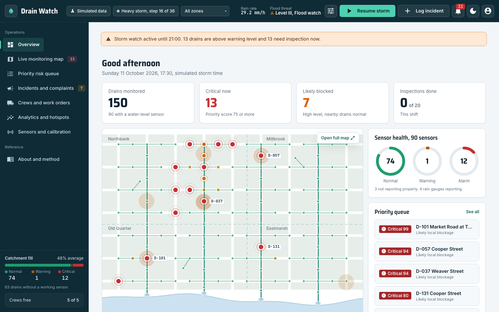
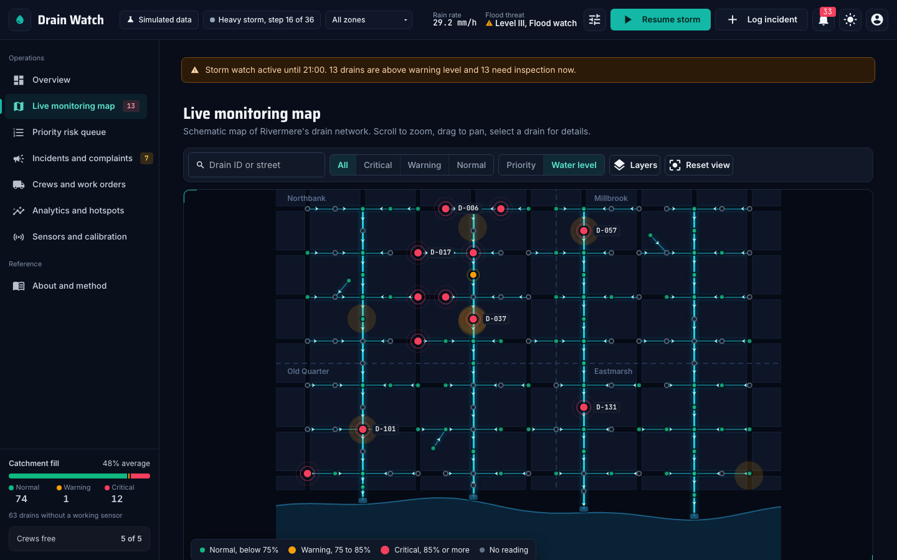
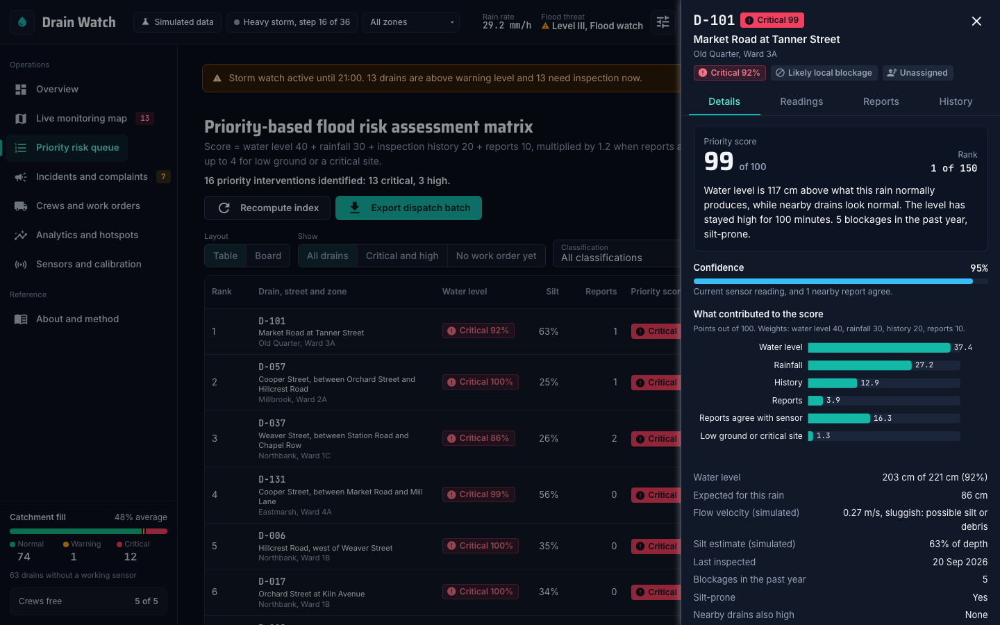

# Drain Watch

Drain Watch ranks drains by inspection priority during heavy rain and explains every rank. It is a decision-support
app for municipal drainage teams who have more drains than crews.

Built by Team Error404 for PySustain-2026, Track 2: water management and sanitation.

> **All data is simulated.** Rivermere is a fictional city. Drain Watch demonstrates a prioritisation method. It does
> not predict floods and does not confirm that a drain is blocked. It tells crews where to look first.



| Dark mode | Drain detail |
|---|---|
|  |  |

## Run it

You need [uv](https://docs.astral.sh/uv/). It installs the right Python version and every dependency.

```bash
uv run app.py
```

The app opens at <http://localhost:8080>. Set `DRAINWATCH_OPEN_BROWSER=0` to stop it opening a browser tab, and `PORT`
to use another port. The database is rebuilt from a fixed seed on every start, so each demo begins the same way.

Map, fonts and icons are served by the app itself, so it works without internet.

### Demo accounts

Demonstration only: shared accounts with a published password and no real security.

| Username | Password | What you see |
|---|---|---|
| `operator` | `demo` | Control room: overview, live map, priority queue, incidents, work orders, analytics, sensors |
| `crew` | `demo` | Field crew: my tasks, task checklist and photos, report a blockage. Built for a phone. |

The sign-in screen lists both accounts, so one click signs you in.

### Tests and lint

```bash
uv run pytest            # scoring, simulator, allocation and service tests
uv run ruff check .
uv run ruff format .
```

## Three-minute demo

1. Sign in as `operator`. Drain Watch tells crews which drain to inspect first while it is still raining.
2. Open **Storm control** (the sliders icon in the top bar), choose **Cloudburst**, then **Start storm**. The map,
   queue and KPIs update every step.
3. Open the top drain in the **Priority risk queue**. Show the reason, the score breakdown and the confidence.
4. Sign in as `crew` on a phone and use **Report a blockage**. The drain's priority rises at once.
5. On **Crews and work orders**, use **Plan crew routes**, preview, then apply. Mark an order as cleared and its
   drain drops down the queue.
6. Show the validation panel on **Analytics** and the limits on **About and method**.
7. Switch between light and dark mode.

## How the score works

Every ten simulated minutes each drain gets a score from 0 to 100:

| Factor | Points | Measures |
|---|---|---|
| Water level | 40 | Level above what this rain normally produces at this drain, divided by its normal spread, compared with nearby drains |
| Rainfall | 30 | Rain over the drain's zone, and how long the level has stayed high |
| Inspection history | 20 | Days since inspection, blockages in the past year, silt-prone |
| Reports | 10 | Recent reports within 75 m, weighted by severity |

The total is multiplied by 1.2 when reports and the sensor agree. Up to 4 more points break ties for low ground and
critical sites. Bands: Critical 75 or more, High 55 to 74, Medium 35 to 54, Low below 35.

Every score carries a label (likely local blockage, possible downstream congestion or widespread flooding, unverified
report, low confidence), a confidence and a plain-language reason built from its three largest factors. Drains
without a working sensor borrow evidence from the drains around them and show lower confidence. The full method is on
the in-app **About and method** page.

### Validation

The simulation plants ten blockages, a congested trunk junction and three faulty sensors, and the ranking never sees
them. The Analytics page reports precision at 10 and recall at 20 against that hidden truth, next to a random ranking.
In the heavy storm at step 16 of 36, precision at 10 is 1.00 against 0.16 for random, and recall at 20 is 0.79 against
0.13. This shows how the method behaves on simulated data, not real-world accuracy.

## Limitations

- All data is simulated, and the method has not been tested on real drains or storms.
- A high rank is a reason to look, not proof of a blockage. Crews confirm on site.
- The map is a schematic of a fictional city.
- Sign-in is demo-grade. Do not deploy this as is.
- Uploaded photos are stored on the server running the app and are visible to everyone using it.

## Project layout

```
app.py                  entry point, page routes, small JSON API under /api
drainwatch/             engine: models, simulator, scoring, network, crew planner, service layer
ui/                     NiceGUI shell, components, charts, map and pages
static/                 self-hosted fonts, stylesheet, favicon, photo uploads
tests/                  pytest suite
```

UI code calls only `drainwatch/service.py`; it never touches the database or the scoring engine directly.

## Team

Team Error404. Python, NiceGUI, FastAPI, SQLModel, NumPy and NetworkX.
